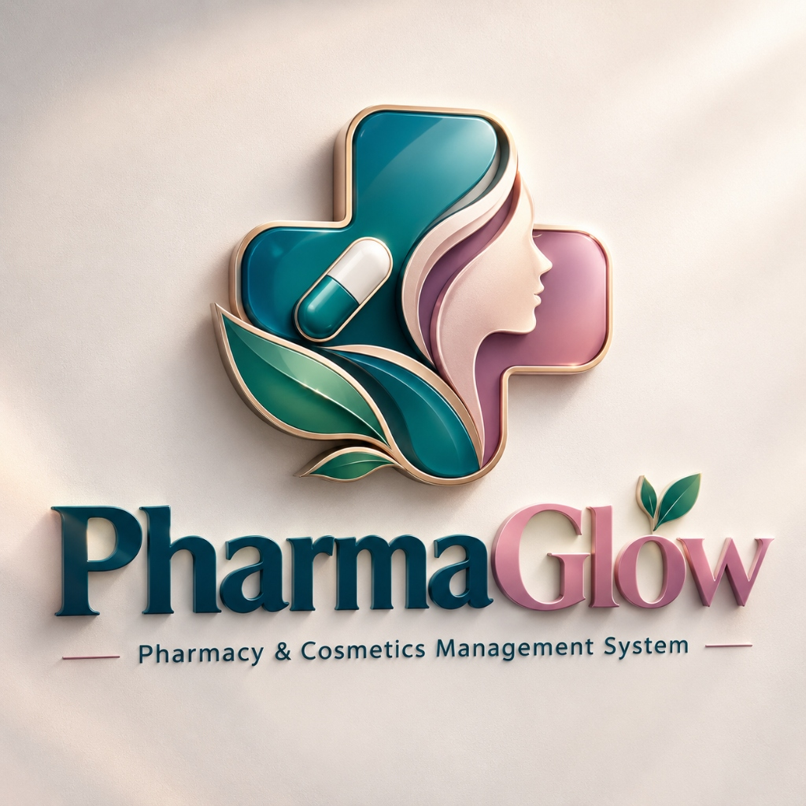

# PharmaGlow — AI-Powered Pharmacy & Cosmetics Management System

<div align="center">
  
  <h3>Healthcare & Beauty Enterprise Management System</h3>
  <p><strong>Developed by Rimsha</strong> • <a href="mailto:rimsha201000@gmail.com">rimsha201000@gmail.com</a></p>
</div>

---

## 🌟 Executive Overview

**PharmaGlow** is a production-grade, responsive enterprise web application purpose-built for modern pharmacies and luxury cosmetic retail. It bridges clinical drug safety with high-speed cosmetic sales, utilizing automated **FEFO (First Expired, First Out)** batch dispensing, strict **Rx prescription verification**, real-time **Expiry Radar quarantine**, and bilingual **Voice AI Search (English & Urdu)** powered by Google Gemini.

---

## 🚀 Key Functional Modules

1. **Animated Landing Page**:
   - Refined healthcare & beauty aesthetics with floating capsules, skincare bottles, botanical accents, and glassmorphic cards.
   - 1-Click Role Switcher bar to instantly preview the interface with tailored permissions.
   - Interactive live status tickers and feature showcases.

2. **Bilingual Voice AI (English & Urdu)**:
   - Voice typing microphone powered by the Web Speech API with real-time waveform animation.
   - Instant language switch between **English (`en-US`)** and **Urdu (`ur-PK`)**.
   - Direct integration with Google Gemini AI for inventory intelligence, near-expiry alerts, daily sales, and supplier payables.
   - Audio text-to-speech (TTS) read-aloud option.

3. **Clinical Pharmacy & FEFO Dispensing**:
   - Comprehensive drug catalog: Generic name, Brand, Dosage form, Strength, Batch #, SKU, Barcode, Storage conditions, and Rx requirement flag.
   - Automated FEFO queueing ensuring batches nearing expiry are dispensed first to prevent spoilage.
   - Stock adjustments and CSV data export/import.

4. **Cosmetics & Beauty Matrix**:
   - Dedicated modules for Skincare, Makeup, Haircare, Fragrances, and Beauty Accessories.
   - Shade/Color swatches, bottle sizes, PAO (Period After Opening: 6M, 12M, 24M), and promotional discount engine.

5. **Expiry Radar & Zero-Tolerance Quarantine**:
   - Automated 4-tier expiry categorization:
     - **Tier 1 (Red)**: Expired or Quarantined (strictly prohibited from POS sales).
     - **Tier 2 (Amber)**: Critical (&le; 30 days remaining).
     - **Tier 3 (Teal)**: Approaching (31–90 days).
     - **Tier 4 (Green)**: Optimal shelf stability.
   - 1-Click batch Quarantine button that locks hazardous items from being billed.

6. **Rapid Point of Sale (POS) & Billing**:
   - Fast barcode scanner input and voice search right at the cash register.
   - **Prescription Check**: Automatically requires Doctor's Name and Rx Serial Number if controlled medications are in the cart.
   - **Safety Enforcement**: Prohibits checkout if any item is expired or quarantined.
   - Multiple payment modes: Cash, Card, EasyPaisa, and Bank Transfer.
   - Printable 80mm thermal tax invoice with barcode, breakdown, and developer credits.
   - Celebratory confetti micro-animation on checkout.

7. **Purchasing & Goods Receiving (GRN)**:
   - Link supplier shipments to new or existing batches with updated expiry dates and costs.
   - Automated supplier accounts payable balance tracking.

8. **Customers & Loyalty Program**:
   - Track customer contact numbers, purchase visits, and loyalty points earned at checkout.

9. **Analytics & Financial Reports**:
   - Real-time calculations for revenue, gross profit margin, inventory valuation (cost basis), and expiry wastage.
   - Printable reports and CSV export format.

10. **Role-Based Access Control (RBAC)**:
    - 6 configured roles: **Super Admin, Admin, Pharmacist, Inventory Manager, Cashier, and Staff**.
    - Complete audit trail logging every critical action.

11. **Developer Watermark**:
    - Permanent watermark badge in the corner of all screens:  
      **Developed by Rimsha | Email: rimsha201000@gmail.com**

---

## 💻 Tech Stack

- **Framework**: React 19 + TypeScript + Vite 5
- **Styling**: Tailwind CSS + Custom Glassmorphism System
- **Icons**: Lucide React
- **Voice Typing**: Web Speech API (`en-US` & `ur-PK`)
- **AI Engine**: Google Gemini Generative API + Grounded Local Analytics
- **Typography**: Plus Jakarta Sans, Outfit, and Noto Nastaliq Urdu
- **Animations**: Canvas Confetti + Custom CSS Keyframe Glows

---

## 🛠️ Local Development Setup

1. **Clone or Download the Repository**:
   ```bash
   git clone https://github.com/your-username/pharmaglow.git
   cd pharmaglow
   ```

2. **Install Dependencies**:
   ```bash
   npm install
   ```

3. **Start Development Server**:
   ```bash
   npm run dev
   ```
   Open your browser at `http://localhost:5173`.

4. **Build for Production**:
   ```bash
   npm run build
   ```
   The production-ready output will be compiled into the `dist/` directory.

---

## 🚀 Vercel Deployment Instructions

PharmaGlow is optimized for single-click deployment on **Vercel**:

### Option 1: Via Vercel Web Dashboard (Recommended)
1. Push this repository to your GitHub account (or drag & drop the folder in GitHub).
2. Go to [vercel.com](https://vercel.com) and log in.
3. Click **"Add New..."** &rarr; **"Project"**.
4. Select your `pharmaglow` repository.
5. In **Framework Preset**, Vercel will automatically detect **Vite**.
6. Set the Build Command: `npm run build` and Output Directory: `dist`.
7. (Optional) Add Environment Variable:
   - `VITE_GEMINI_API_KEY`: Your Gemini API Key (or configure it directly inside the app's Settings page).
8. Click **"Deploy"**. The site will be live in under 30 seconds!

### Option 2: Via Vercel CLI
```bash
npm install -g vercel
vercel
```

---

## 👤 Preconfigured Demo Accounts

You can test all access tiers with one click using the **Quick Role Switcher** in the top navigation bar, or using these credentials:

| Role | Email | Password | Primary Permissions |
| :--- | :--- | :--- | :--- |
| **Super Admin** | `superadmin@pharmaglow.com` | `admin123` | Full Access, Users, Audits, Settings |
| **Admin** | `admin@pharmaglow.com` | `admin123` | Store Ops, Sales, Inventory, Reports |
| **Pharmacist** | `pharmacist@pharmaglow.com` | `pharma123` | FEFO Medicines, Rx Verification, Expiry |
| **Inventory Manager** | `inventory@pharmaglow.com` | `inv123` | Batches, Suppliers, Purchasing |
| **Cashier** | `cashier@pharmaglow.com` | `cashier123` | Rapid POS, Checkout, Customer Loyalty |
| **Staff** | `staff@pharmaglow.com` | `staff123` | Catalog Inquiries & Customer Guidance |

---

## 📜 Credits & Contact

- **Application**: PharmaGlow Pharmacy & Cosmetics Management System
- **Developer**: Rimsha
- **Email**: [rimsha201000@gmail.com](mailto:rimsha201000@gmail.com)
